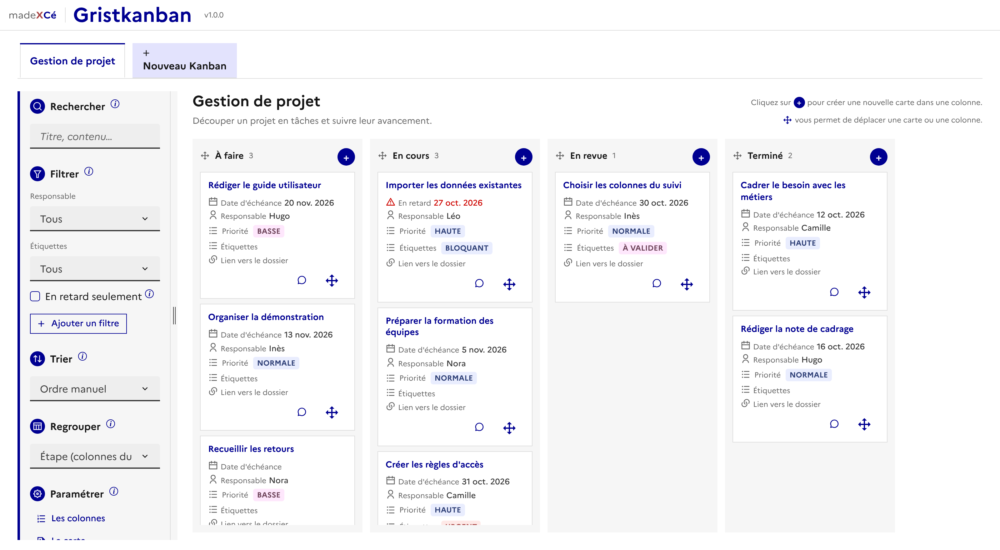

# 📋 Gristkanban

Un widget personnalisé pour [Grist](https://www.getgrist.com) : des Kanbans pour tous, sans connaissance technique.

Tous les Kanbans d'un document vivent dans le même widget, en onglets. Le dernier onglet, « Nouveau Kanban », en crée un autre.

Tout se paramètre dans le widget, sans toucher au code.

## Deux façons de commencer

- **Je n'ai pas encore de données** : un Kanban vierge, ou l'un des modèles prêts à l'emploi (gestion de projet, suivi des demandes, recrutement, organisation d'un événement, courrier et parapheur, formations, contrats et conventions, gestion des risques...). Le widget crée tout.
- **J'ai déjà des données** : Gristkanban propose des Kanbans d'après les tables du document (colonne d'étape, titre, échéance, responsable), ou vous laisse le brancher librement sur une de vos tables.

Une barre d'étapes guide la création : le Kanban, les colonnes, les informations des cartes, la carte et la fiche, les filtres, puis la vérification. Rien n'est écrit dans le document avant « Créer mon Kanban ».

## Au quotidien

- **Glisser-déposer** des cartes et des colonnes, avec un bouton Déplacer pour qui ne peut pas glisser.
- **Fiche latérale** enregistrée automatiquement, pièces jointes comprises, avec un fil d'activité et des commentaires.
- **Recherche, filtres, tri** et « Regrouper par » (responsable, priorité...).
- **Cartes à votre goût** : informations choisies et ordonnées, image de couverture, couleur selon une valeur, mode compact, échéances en retard signalées.
- **Mise à jour automatique** quand le document change.

## Installation

1. Dans votre document Grist, ajoutez une vue de type **Personnalisée**.
2. Choisissez l'**URL personnalisée** et collez :
   `https://cezionlyone.github.io/grist-widgets/dsfr/gristkanban/`
3. Dans le panneau de droite, rubrique **Accès**, choisissez **Accès complet**.
4. Laissez-vous guider pour créer votre premier Kanban.

## Ce que le widget écrit dans votre document

- Une table technique `BIBLIOTHEQUE_KANBAN_`, créée avec le premier Kanban : une ligne de réglages par Kanban.
- Une table `KANBAN_CARTES`, seulement pour les Kanbans créés par le widget : une seule table pour tous, chaque carte porte l'identifiant de son Kanban.
- Pour un Kanban branché sur une de vos tables : seulement une colonne `ORDRE` pour retenir le rangement des cartes, annoncée avant la création, et les deux colonnes du fil d'activité si vous cochez l'option. Aucune colonne n'est jamais retypée ni supprimée.

## Droits

- **Lecteurs** : consultation, recherche, filtres, fiche en lecture.
- **Éditeurs** : en plus, ajout, modification, déplacement et suppression des cartes, commentaires.
- **Propriétaires** : en plus, paramétrage, création et suppression des Kanbans.

Le réglage des règles d'accès est expliqué dans les paramétrages du widget.

## Accessibilité

- Barre d'étapes et onglets utilisables au clavier.
- Alternatives au glisser-déposer : bouton Déplacer, colonne et position dans la fiche.
- Enregistrements annoncés aux lecteurs d'écran, couleur jamais seule porteuse d'information.

## Dépendances

- [DSFR](https://www.systeme-de-design.gouv.fr) v1.13.1 (Système de design de l'État)
- [SortableJS](https://sortablejs.github.io/Sortable/) v1.15.6 (glisser-déposer)
- API des widgets Grist (`grist-plugin-api.js`)
- [pdf.js](https://mozilla.github.io/pdf.js/) v6.2.108, chargé seulement pour afficher les PDF joints, avec vérification de son empreinte

> **À savoir :** les modalités d'utilisation du DSFR le réservent aux sites de l'État. Vérifiez qu'elles s'appliquent à votre usage avant de déployer ce widget.

## Licence

[MIT](../../LICENSE) : vous pouvez utiliser, modifier et redistribuer ce widget librement, en conservant la mention de l'auteur.

🇬🇧 English edition, without the DSFR: [en/gristkanban](../../en/gristkanban/)

---

made **X** Cé
