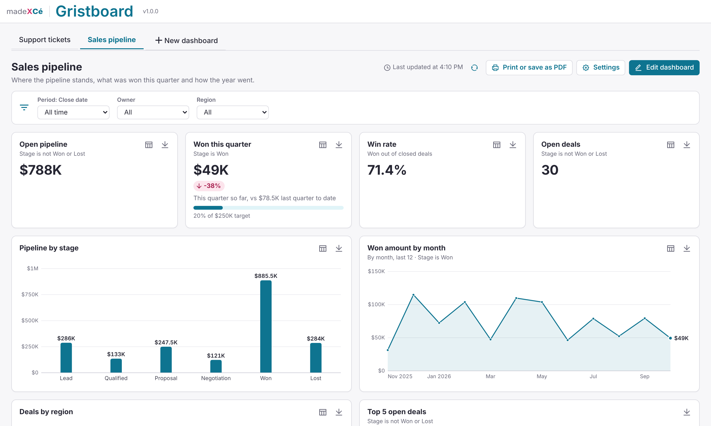
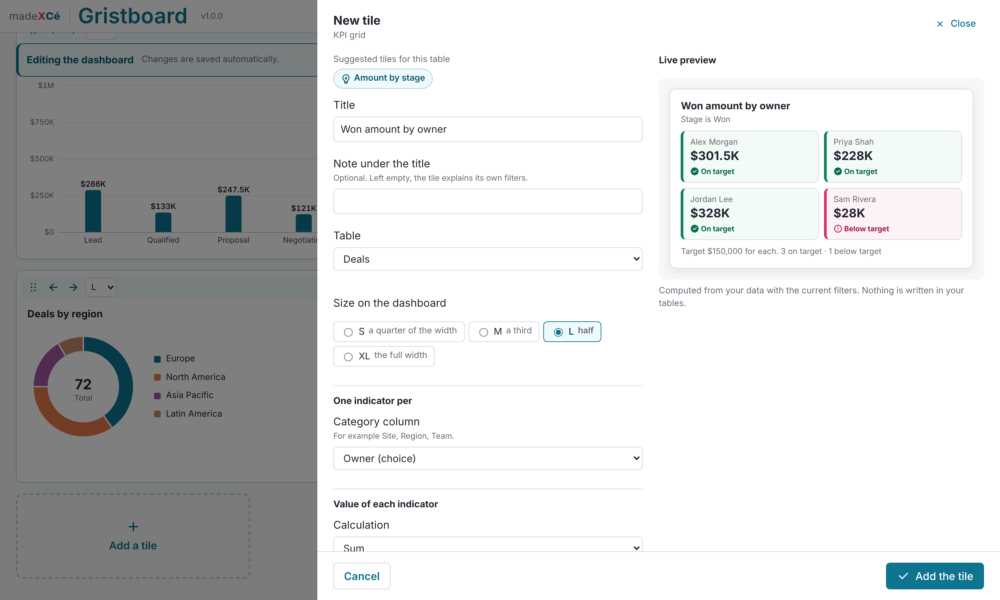

# 📊 Gristboard

A custom widget for [Grist](https://www.getgrist.com): dashboards in a few clicks. Indicators suggested from your tables, no summary tables, no formulas.

All the dashboards of a document live in the same widget, as tabs. The last tab, "New dashboard", creates another one.

Everything is set up inside the widget, without touching any code. A dashboard only reads your data: it never writes in your tables.

## Two ways to start

- **I already have data**: Gristboard looks at the tables of your document (row counts, column types, value distributions) and suggests ready dashboards: a count, the total of the main amount, a bar chart by the most useful choice column, a line over time, a donut, the latest rows. Each suggestion shows a preview of its tiles. You can also connect to any of your tables: the widget guesses the useful columns from their type and their name, in English and French. Or start from a blank dashboard.
- **I don't have any data yet**: six ready-made templates: sales pipeline, support tickets, project portfolio health, inventory, event registrations, budget tracking. The widget creates the tables (columns, choice lists, sample rows dated around today if you like), after asking you, then a ready dashboard. If you change your mind, it offers to delete them.

A step bar guides you through: the starting point, the name and filters, the tiles, then a review. Nothing is saved before you click "Create my dashboard".

## Day to day

- **Tiles**: KPI (count, sum, average, min, max, distinct count, sum of quantity × price, average time between two dates, share of rows), with a trend against the previous period and a target; KPI grid (one small indicator per site, team or category, colored against its target, with words too); bar charts, grouped or stacked; line and area charts by day, week, month, quarter or year, cumulative if you like; donut; radar; top rows or pivot table; progress list against targets; latest rows; text and headings.
- **Filters**: one row above the tiles, with a period on a date column (this week, this month, this quarter, this year, a given year, last 12 months, a custom range) and up to three choice filters. Each tile can add its own filters.
- **Explore**: hover or focus any bar, slice or point for its value; click it to list the matching rows in a side panel, then open a row in Grist.
- **View data and export**: every chart has a data table view and a CSV export.
- **Edit in place**: owners switch to "Edit dashboard" to add, edit (with a live preview), duplicate, resize, reorder and delete tiles. Changes are saved automatically, and Undo is one click away.
- **Print or save as PDF**, in landscape, on the paper size of your country.
- **Automatic updates** when the document changes, with a "Last updated at" stamp.

## Why Gristboard

- **Indicators suggested from your tables**: start from a ready dashboard instead of a blank page.
- **No summary tables, no formulas**: every figure is computed by the widget from your rows, also on 50,000 rows.
- **Read-only on your data**: a dashboard never changes your tables.
- **Accessible data views**: a table for every chart, keyboard access to every mark, color never alone.
- **Your document's formats**: dates, numbers, currency and time zone as set in Grist.
- **The madeXcé family**: the same tabs, setup steps and look as Gristkanban and Gristcity.

## Installation

1. In your Grist document, add a **Custom** widget.
2. Choose **Custom URL** and paste:
   `https://cezionlyone.github.io/grist-widgets/en/gristboard/`
3. In the right panel, under **Access**, choose **Full document access**.
4. Follow the steps to create your first dashboard.

## What the widget writes in your document

- A technical table `BOARD_LIBRARY_` ("📊 BOARD LIBRARY ⚡"), created with the first dashboard: one settings row per dashboard, and two rows used by the access rules.
- The tables of a template, only if you pick one and confirm.
- Nothing else: your tables are only read. They are never written to, retyped or restructured.

## Your formats

Dates, times, numbers and currency follow your document's settings in Grist (Document settings: locale, currency, time zone), and each column keeps the format you chose for it in Grist. Numbers and amounts use your locale's separators (8.008,00 € in a German document, $8,008.00 in an American one), and the numbers you type in the widget too. Weeks, months and quarters are counted from today in your document's time zone, and a date-and-time value falls on the day its cell shows (the time zone of its column); weeks start on Monday, or on Sunday where that is the custom. CSV exports use a semicolon where the decimal separator is a comma. The interface itself is in English.

## Permissions

- **Viewers and editors**: view the dashboards, use the filters, open the data views, export and print.
- **Owners**: also create, edit and delete dashboards.

How to set the access rules is explained in the dashboard settings.

## Accessibility

- Step bar, tabs, tiles and chart marks fully usable with the keyboard (arrow keys move along line charts).
- Tooltips on keyboard focus as on hover, and a data table for every chart.
- Move earlier and Move later buttons as an alternative to drag and drop.
- Values, words and icons always accompany colors; saves and changes announced to screen readers.

## Dependencies

- Grist widget API (`grist-plugin-api.js`)
- Icons: [Remix Icon](https://remixicon.com), embedded in the file

No chart library, no external stylesheet and no web font: the charts are drawn by the widget and the madeXcé theme is built in.

## License

[MIT](../../LICENSE): you are free to use, modify and redistribute this widget, keeping the author's credit.

---

made **X** Cé
