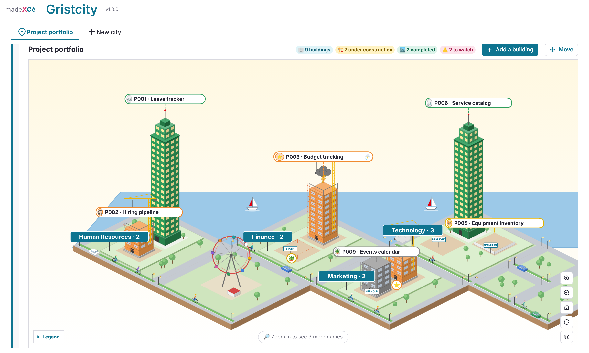
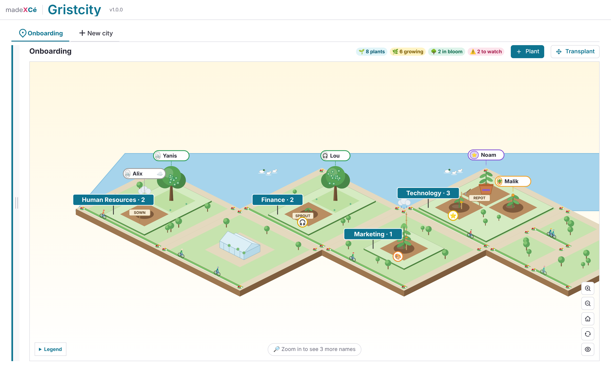

# 🏙️ Gristcity

A custom widget for [Grist](https://www.getgrist.com) that draws a table as an isometric 3D city.

Each row becomes a building that rises through its stages: reserved lot, construction site, finished building, skyscraper... Districts group the buildings by a column of your choice. The weather flags what needs watching (clouds) or what is on alert (storm).

Everything is set up inside the widget, without touching any code.

## Six worlds

| World | Each row becomes | Great for |
|---|---|---|
| 🏙️ City | a building | projects, requests, cases |
| 🌳 Garden | a plant | people's journeys, onboarding, training |
| 🚗 Garage | a vehicle | a vehicle fleet, equipment |
| ✈️ Airport | a plane | trips, visits, delegations |
| 🚀 Space base | a rocket | ideas, innovation |
| ⚓ Harbor | a ship | programs, partnerships |

## Installation

1. In your Grist document, add a **Custom** widget.
2. Choose **Custom URL** and paste:
   `https://cezionlyone.github.io/grist-widgets/en/gristcity/`
3. In the right panel, under **Access**, choose **Full document access**.
4. Follow the setup wizard: pick a world, then start from a ready-made template or connect the widget to one of your tables.

## What the widget does

- **Setup wizard** in 8 steps, with a preview that builds itself as you answer.
- **Ready-made templates**: project portfolio, team workload, request tracking, application portfolio, org chart, vehicle fleet, business trips, innovation portfolio, partnership programs, onboarding. The widget creates the tables, with sample rows if you want them.
- **Several cities per document**, as tabs.
- **Editable details** for each building, attachments included (images and PDFs open in a viewer).
- **Move mode**: drag a building to another district and the matching column is updated.
- **Filters, search and a list view**, an accessible alternative to the map.

## What the widget writes in your document

- A technical table `CITY_LIBRARY_`, created with the first city: one settings row per city, plus one marker row (`SETTINGS_ACCESS`) used to restrict settings to owners.
- In the table it draws: only the values edited in the details panel, the buildings you add and the moves. Its structure is never changed.
- The tables of a template, only if you choose one.

## Your formats

Dates, times, numbers and currency follow your document's settings in Grist (Document settings: locale, currency, time zone), and each date column keeps the format you chose for it in Grist. Date-and-time columns created by the widget use your document's time zone. The interface itself is in English.

## Permissions

The widget follows everyone's access in the document:

- **Viewers**: browse, search, filter, read the details.
- **Editors**: also edit the details, add buildings and move them.
- **Settings**: can be restricted to owners with an access rule. The widget shows how.

## Accessibility

- Map, tabs and setup wizard fully usable with the keyboard (arrow keys between items, Enter to open the details).
- A list view shows the same rows as a table, the accessible alternative to the map.
- Alternative to drag and drop: in Move mode, press D on an item, then choose its new district.
- Saves and results announced to screen readers; color never carries information on its own.

## Dependencies

- Grist widget API (`grist-plugin-api.js`)
- [pdf.js](https://mozilla.github.io/pdf.js/) v6.2.108, loaded only to display attached PDFs, with an integrity check
- Icons: [Remix Icon](https://remixicon.com), embedded in the file

No external stylesheet and no web font: the madeXcé theme is built in.

## License

[MIT](../../LICENSE): you are free to use, modify and redistribute this widget, keeping the author's credit.

---

made **X** Cé
