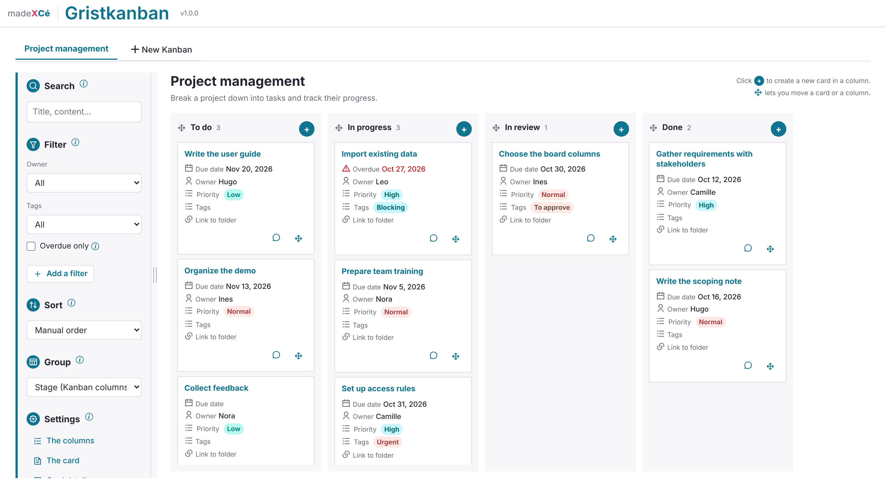

# 📋 Gristkanban

A custom widget for [Grist](https://www.getgrist.com): Kanbans for everyone, without touching your tables.

All the Kanbans of a document live in the same widget, as tabs. The last tab, "New Kanban", creates another one.

Everything is set up inside the widget, without touching any code.

## Two ways to start

- **I don't have any data yet**: a blank Kanban, or one of eleven ready-made templates: request tracking, project management, recruitment, event planning, content calendar, customer support tickets, sales pipeline, training sessions, bug tracking, contracts and agreements, risk management. The widget creates everything.
- **I already have data**: Gristkanban looks at the tables of your document and suggests ready-made Kanbans (stage column, title, due date, owner), or lets you connect it to any of your tables yourself.

A step bar guides you through: the Kanban, the columns, the card fields, the card, the card details, the filters, then a review. Nothing is written to your document until you click "Create my Kanban".

## Day to day

- **Drag and drop** cards and columns, with a Move button for those who cannot drag.
- **Card details** in a side panel, saved automatically, with attachments, comments and an activity feed.
- **Search, filters, sorting** and "Group by" (owner, priority...).
- **Cards your way**: chosen and ordered fields, cover image, color based on a value, compact mode, overdue dates flagged.
- **Automatic updates** when the document changes.

## Installation

1. In your Grist document, add a **Custom** widget.
2. Choose **Custom URL** and paste:
   `https://cezionlyone.github.io/grist-widgets/en/gristkanban/`
3. In the right panel, under **Access**, choose **Full document access**.
4. Follow the steps to create your first Kanban.

## What the widget writes in your document

- A technical table `KANBAN_LIBRARY_`, created with the first Kanban: one settings row per Kanban.
- A `KANBAN_CARDS` table, only for Kanbans created by the widget: one table for all of them, each card carries the id of its Kanban.
- For a Kanban connected to one of your tables: only a `SORT_ORDER` column to remember the order of the cards (announced before creation), and the two activity feed columns if you tick that option. Columns are never retyped or deleted.

## Your formats

Dates, times, numbers and currency follow your document's settings in Grist (Document settings: locale, currency, time zone), and each date column keeps the format you chose for it in Grist. Date-and-time columns created by the widget use your document's time zone. The interface itself is in English.

## Permissions

- **Viewers**: browse, search, filter, read card details.
- **Editors**: also add, edit, move and delete cards, and comment.
- **Owners**: also change the settings, create and delete Kanbans.

How to set the access rules is explained in the widget's settings.

## Accessibility

- Step bar and tabs fully usable with the keyboard.
- Alternatives to drag and drop: Move button, column and position in the card details.
- Saves announced to screen readers; color never carries information on its own.

## Dependencies

- [SortableJS](https://sortablejs.github.io/Sortable/) v1.15.6 (drag and drop)
- Grist widget API (`grist-plugin-api.js`)
- [pdf.js](https://mozilla.github.io/pdf.js/) v6.2.108, loaded only to display attached PDFs, with an integrity check
- Icons: [Remix Icon](https://remixicon.com), embedded in the file

No external stylesheet and no web font: the madeXcé theme is built in.

## License

[MIT](../../LICENSE): you are free to use, modify and redistribute this widget, keeping the author's credit.

---

made **X** Cé
