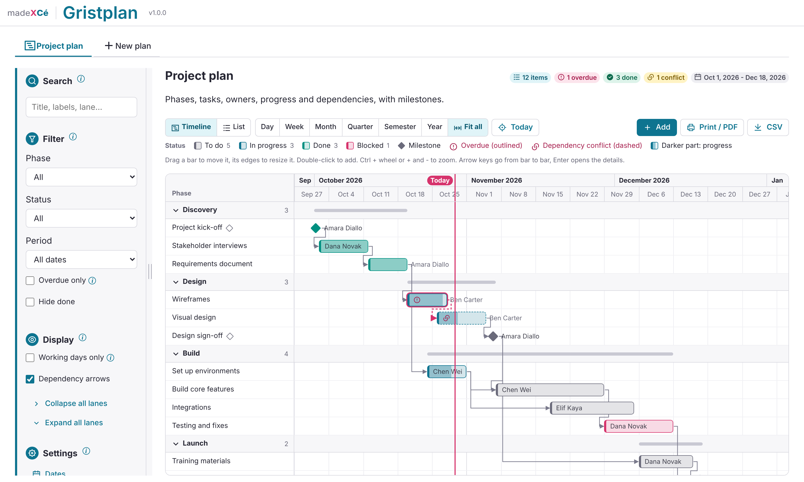
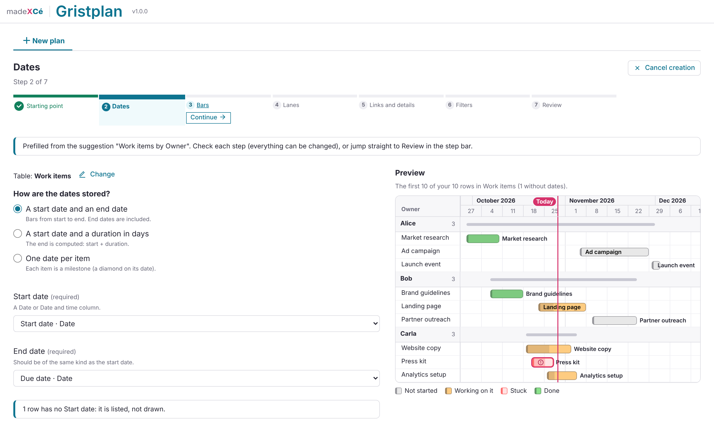

# 📅 Gristplan

A custom widget for [Grist](https://www.getgrist.com): timelines and Gantt charts for everyone, with ready-made plans or plans suggested from your tables.

All the plans of a document live in the same widget, as tabs. The last tab, "New plan", creates another one.

Everything is set up inside the widget: no code to paste, no table model to copy, no column type to change. Gristplan works on the document you already have.

## Two ways to start

- **I don't have any data yet**: seven ready-made templates: project plan, product roadmap, event planning, room and equipment booking, content calendar, team rotation, hiring plan. Gristplan creates the tables, their columns and choice lists, with a few sample rows dated from today if you wish.
- **I already have data**: Gristplan looks at the tables of your document and suggests ready-made plans ("Tasks by Owner"), with a small preview of their bars. It recognises dates, titles, lanes and statuses from English and French column names (Start, Due date, Owner, Status, Date de début, Échéance, Responsable, Statut...). You can also start from any table: each step guesses which column goes where, and you change what you like.

Your tables are never restructured: no column is added, retyped or deleted, and nothing is copied. Gristplan reads your rows and writes only the dates and fields you edit.

A step bar guides you through: the starting point, the dates, the bars, the lanes, links and details, the filters, then a review. A live preview of your own rows is shown from the dates step on. Nothing is written to your document until you click "Create my plan" (template tables are created only after you confirm, and Gristplan offers to delete them if you change your mind).

## Day to day

- **Timeline and Gantt**: bars between a start and an end date (or a start and a duration), milestones as diamonds, lanes by owner, team, phase, room... An item with several owners (reference list or multiple choice) appears in each of their lanes.
- **Zoom**: Day, Week, Month, Quarter, Semester, Year and Fit all, Ctrl + mouse wheel, a two-level header with week numbers, weekends shaded or hidden ("Working days only"), a Today line.
- **Colors** from your own Grist choice colors, a legend, progress inside the bars, dependency arrows, and flags for overdue items, dependency conflicts and overlapping bookings.
- **Editing**: drag a bar to move it, drag its edges to resize it, double-click to add an item. The details panel saves automatically, with "Move by" buttons (one day, one week) and Undo of the last move.
- **Search and filters**: lane, color value, period (this week, this month, next 3 months, custom dates), overdue only, hide done.
- **List view**: a sortable table of the items with a summary, also the accessible alternative to the timeline.
- **Export**: Print / PDF of the visible period on landscape paper, and CSV of the visible items.
- **Automatic updates** when the document changes, keeping your zoom, scroll and open lanes.

## Installation

1. In your Grist document, add a **Custom** widget.
2. Choose **Custom URL** and paste:
   `https://cezionlyone.github.io/grist-widgets/en/gristplan/`
3. In the right panel, under **Access**, choose **Full document access**.
4. Follow the steps to create your first plan.

## What the widget writes in your document

- A technical table `PLAN_LIBRARY_` (shown as "📅 PLAN LIBRARY ⚡"), created with the first plan: one settings row per plan, and two marker rows used by the access rules.
- For a template only: its tables (for example Tasks and Team), created after your confirmation.
- For a plan on your own table: nothing structural. Only the values you change (dates when you drag a bar, fields in the details panel) are written.

## Your formats

Dates, times, numbers and currency follow your document's settings in Grist (Document settings: locale, currency, time zone), and each date column keeps the format you chose for it in Grist. Date-and-time columns are shown in their own time zone, and those created by the widget use your document's time zone. Weeks start on Sunday in the US, Canada and a few other countries, on Monday elsewhere, with matching week numbers. Print uses US Letter in North America and A4 elsewhere; CSV files use ";" where the decimal separator is ",". The interface itself is in English.

## Permissions

- **Viewers**: browse, zoom, search, filter, read item details, print and export.
- **Editors**: also move, resize, add, edit and delete items.
- **Owners**: also change the settings, create and delete plans.

How to set the access rules is explained in the widget's settings (step "Filters").

## Accessibility

- Step bar, tabs and timeline fully usable with the keyboard: arrow keys go from bar to bar, Enter opens the details, + and - zoom.
- "Move by" buttons as an alternative to dragging; the list view as an alternative to the timeline.
- Saves announced to screen readers; color never carries information on its own (icons, outlines and text); reduced motion respected.

## Dependencies

- Grist widget API (`grist-plugin-api.js`)
- Icons: [Remix Icon](https://remixicon.com), embedded in the file

No other library, no external stylesheet and no web font: the timeline and the madeXcé theme are built in.

## License

[MIT](../../LICENSE): you are free to use, modify and redistribute this widget, keeping the author's credit.

---

made **X** Cé
