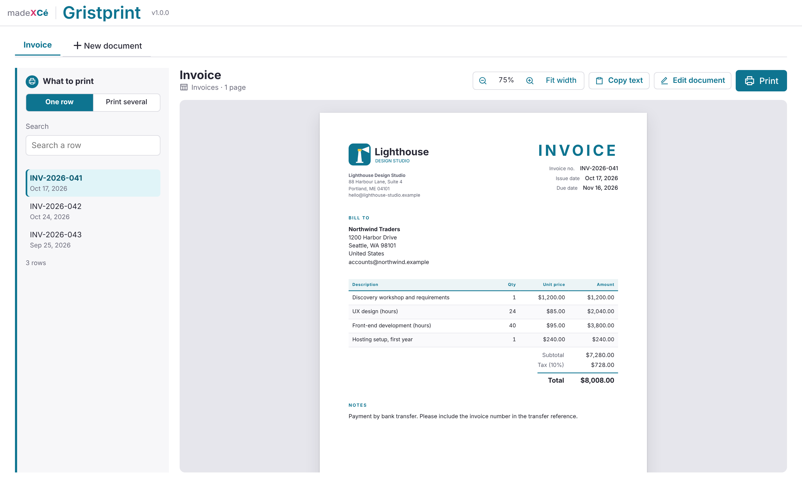
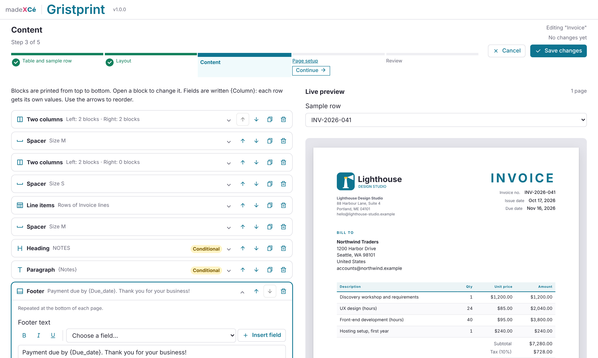

# 🖨️ Gristprint

A custom widget for [Grist](https://www.getgrist.com): invoices, certificates, letters and record sheets from your Grist rows. Pick a template, place your fields, print or save as PDF, without writing any HTML.

All the document templates of a Grist document live in the same widget, as tabs. The last tab, "New document", creates another one. A template is tied to one table, and a table can have several templates (an invoice and a packing slip from the same orders, for example).

Everything is set up inside the widget, without touching any code.

## Two ways to start

- **I don't have any data yet**: seven ready-made templates: invoice, quote / estimate, packing slip, letter, certificate of completion, record sheet, badges and name tags. The widget creates the tables (columns, choice lists, a calculated line total, optional sample rows) and a polished document you can adjust. If you abandon the creation, it offers to delete those tables.
- **I already have data**: Gristprint looks at the tables of your document and suggests ready-made documents, each with a thumbnail of the page: a table referenced by a table of lines with numbers gives an invoice style document with its line items; people with an address give a letter; people with a course and a date give a certificate; attendees give badges; any other table gives a record sheet. You can also connect it to any of your tables: the widget guesses the role of your columns (name, number, dates, client, address...), in English or French.

A step bar guides you through: starting point, table and sample row, layout, content, page setup, then a review. Nothing is written to your document until you click "Create my document".

## Building a document

A document is a list of blocks, edited with ordinary form fields and a live preview next to them:

- **Heading** and **paragraph**, with fields inserted from a picker (`{Client}`, `{Client.Address}`, `{today}`), bold, italic, underline, alignment and size. A line made only of empty fields is skipped, so an address without its second line leaves no gap.
- **Field list**: label and value pairs, in one or two columns.
- **Line items**: the rows of another table that reference this row (invoice lines, order items), with the columns of your choice and totals: subtotal, tax rate and grand total in your document's currency. The table of lines and its reference column are picked automatically when there is only one candidate.
- **Image**: your logo (uploaded once in Page setup) or the images of an Attachments column.
- **Two columns**, **signature**, **divider**, **spacer**, **page break**, and a **footer** repeated on every page with "Page 1 of 2".
- **Show only if**: any block can be shown only when a field is filled, empty, equal to a value, or ticked.

References are always shown by their display column (the client's name, never a row number), choice lists are joined with commas, yes/no columns read "Yes" or "No" (or your own words), and each column keeps its Grist format.

Page setup: US Letter, US Legal, A4 or A5, portrait or landscape, margins, brand color, sans-serif or serif font, page border, logo position and size, and the grid of labels per page for badges.

## Day to day

- **One row**: the document follows the row selected in Grist when the widget is linked to the table; otherwise, pick a row in the searchable list.
- **Print several**: tick rows (search, filter by a column value, "Select all shown"), or print exactly the rows shown by the linked Grist view, with its filters. One document per row, each starting on a new page, in a **single print job**: "Save as PDF" gives one PDF.
- **Print one by one**: one print dialog per document, when you need one PDF file per row. The file name is suggested from the document (for example "Invoice - INV-2026-041"). A browser cannot split a single print job into several files, hence this option.
- **Mark as printed** (optional, off by default, editors only): after printing, the widget asks whether to tick a yes/no column or set a date column for the printed rows, and adds a "Not printed yet" filter.
- **WYSIWYG preview** at real proportions, with zoom; **Copy text** copies the text of the document. In "Print several", the button reads **Copy preview text**: it copies only what the preview shows (the first documents), not every selected row.
- **Renamed tables and columns**: renaming a table or a column in Grist does not break a document. Its fields, line items and "mark as printed" column follow the new names, and the template is updated the next time it is saved.
- **Automatic updates** when the document changes.

Printing uses your browser's own print dialog, so a PDF saved from it contains real text: sharp at any zoom, searchable, with tables and images intact. No screenshot of the page is taken, no PDF library is involved.

## Installation

1. In your Grist document, add a **Custom** widget.
2. Choose **Custom URL** and paste:
   `https://cezionlyone.github.io/grist-widgets/en/gristprint/`
3. In the right panel, under **Access**, choose **Full document access**.
4. Optional: under **SELECT DATA**, choose the table you print from (for example Invoices), so the document follows the selected row and "Print several" can print the rows shown by that table.
5. Follow the steps to create your first document.

## What the widget writes in your document

- A technical table `PRINT_LIBRARY_` (shown as "🖨️ PRINT LIBRARY ⚡"), created with the first document: one settings row per document template, holding the template as structured data (never HTML), and the logo you upload, kept in its FILES column so Grist keeps the file.
- Only for ready-made templates: their tables (for example Clients, Invoices and Invoice lines), each on its own page, with optional sample rows. These are announced and confirmed before creation.
- Your own tables are only read. The single exception is the optional "mark as printed" write-back, into the yes/no or date column you choose, after your confirmation. Columns are never created, retyped or deleted in your tables.

## Your formats

Dates, numbers and currency follow your document's settings in Grist (Document settings: locale, currency, time zone), and each column keeps the format you chose for it in Grist (date format, decimals, currency, percentage). Amounts without a currency of their own use your document's currency. The default paper size is US Letter in the United States, Canada and Mexico, A4 elsewhere. The interface itself is in English.

## Permissions

- **Viewers**: see and print every document, in one or several rows.
- **Editors**: also use "mark as printed".
- **Owners**: also create, edit and delete document templates.

People with read-only access (viewers, or a document opened read-only) never get "Edit document", "New document" or "Mark as printed": Grist tells the widget. Without access rules, though, every editor can also change the templates. To reserve them for owners, add the access rules explained in the widget, at the review step: they hide the settings from non-owners and deny them Create, Update and Delete on the `PRINT_LIBRARY_` table. Hiding buttons is only a convenience: the real protection comes from these rules and the document permissions.

## Accessibility

- Tabs, step bar, block editor and row list fully usable with the keyboard, with a visible focus.
- The page preview is real text, read by screen readers; blocks are reordered with buttons, not by dragging.
- Saves and changes announced to screen readers; color never carries information on its own.

## Dependencies

- Grist widget API (`grist-plugin-api.js`)
- Icons: [Remix Icon](https://remixicon.com), embedded in the file

No other library, no external stylesheet and no web font: the madeXcé theme is built in.

## License

[MIT](../../LICENSE): you are free to use, modify and redistribute this widget, keeping the author's credit.

---

made **X** Cé
