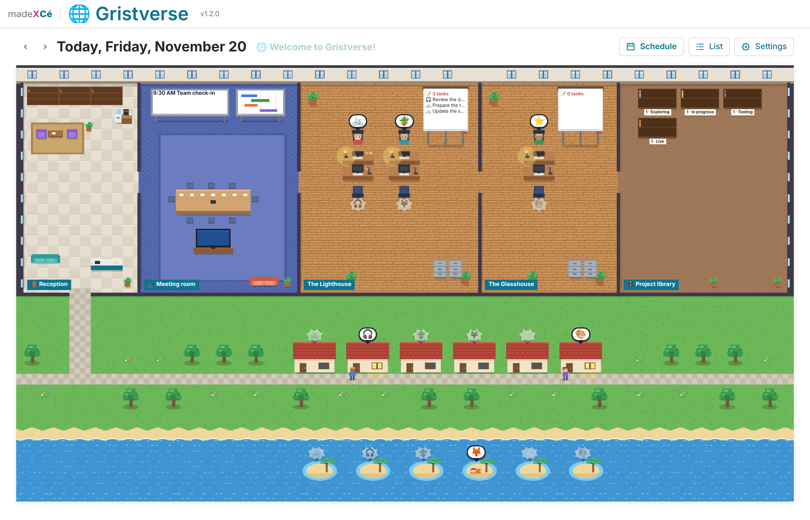

# 🌐 Gristverse

A custom widget for [Grist](https://www.getgrist.com): your team's virtual office, drawn in pixel art.

Everyone has their emoji, their desk, their house and their island. See at a glance who is at the office, who is working remotely and who is away, and declare yourself in one click: your character walks over, on foot, by bike or on a scooter.

Everything is set up inside the widget, without touching any code.

## The map

- **One building per site**, with one desk per person. Desks are laid out automatically, or square by square.
- **The common area**: reception, the meeting room and the project library.
- **Outside**: one house per person for remote work, and one island for absences.

## The rooms

Each room is optional. Gristverse creates its table, or you connect it to a table that already exists in your document.

| Room | What you find there |
|---|---|
| 🪑 Everyone's desk | Where they work, day by day or by period; their tasks on the flipchart; their activities (hours per project) and their monthly timesheet; their meetings |
| 📺 Meeting room | Today's meetings, a reminder 15 minutes before, the video call button, the TV that opens your chat channel |
| 📚 Resources | Useful links and documents on the reception shelves, with a search; attached files open in the widget |
| 🗄️ Project library | One shelf per status, one binder per project with its card and documents, and the project schedule |
| 👋 Reception | The "who is where" schedule, with totals per site and per day |

## Installation

1. In your Grist document, add a **Custom** widget.
2. Choose **Custom URL** and paste:
   `https://cezionlyone.github.io/grist-widgets/en/gristverse/`
3. In the right panel, under **Access**, choose **Full document access**.
4. Follow the 5-step setup wizard: the template (two sites, one site or custom), the team, the rooms, the desk layout, then "Open Gristverse". Sample data is offered so you can explore right away.

## Attachments

"Attachments" columns in the projects and resources tables show their files. Images and PDFs open in a viewer (full screen available), in every browser including Firefox. Other files are downloaded. Gristverse only reads files: it never uploads or removes any.

## What the widget writes in your document

- The tables of the rooms you choose, only if you do not connect them to existing tables: Team, Presence, Meetings, Tasks, Resources, Projects, Activities.
- A technical table `GRISTVERSE_LIBRARY_` that stores the settings.
- In existing tables: only presence declarations, tasks, activities and edited values. Their structure is never changed.

## Monthly timesheet

Each person can download a timesheet for any month: hours per project, absences, the comparison with the working days of the month, and a printable PDF. In **Settings** ("The rooms" step), choose the length of a working day (8 hours by default) and the public holidays to remove from working days: none, United States, United Kingdom, Canada, Australia, France, Germany, Spain, Italy, Belgium, Switzerland or the Netherlands. Other countries can be added in the code.

## Your formats

Dates, times, numbers and currency follow your document's settings in Grist (Document settings: locale, currency, time zone). The PDF timesheet uses US Letter paper in North America and A4 elsewhere. The interface itself is in English.

## Accessibility

- Every desk and every room is a keyboard-accessible button with a full name.
- A list view replaces the map for screen readers.
- The desk layout has a table equivalent to the clickable grid.
- Animations stop when the system asks to reduce motion.

## Dependencies

- Grist widget API (`grist-plugin-api.js`)
- [pdf.js](https://mozilla.github.io/pdf.js/) v6.2.108, loaded only to display attached PDFs, with an integrity check
- Icons: [Remix Icon](https://remixicon.com), embedded in the file

No external stylesheet and no web font: the madeXcé theme is built in.

## License

[MIT](../../LICENSE): you are free to use, modify and redistribute this widget, keeping the author's credit.

---

made **X** Cé
